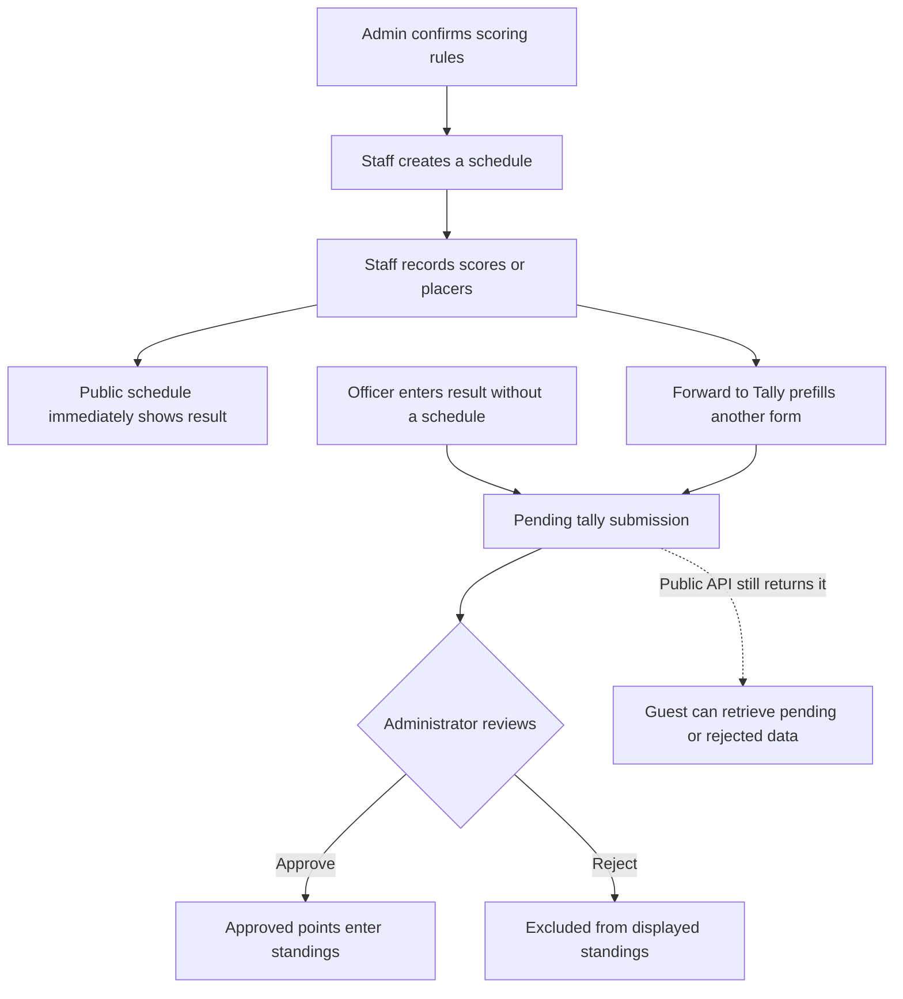

# Siklab 2026 baseline system audit

## Verdict and scope

**The system can run locally, but does not yet meet the agreed event-day requirements.** It has useful scheduling, tally submission, review, and public-display foundations. It is not ready for a public launch or the proposed 500-viewer/20-staff workload.

Baseline: commit `3bab3f9e0708d2cdd85f1bae3a17ec16f090b1de`, branch `audit/local-baseline`. Verification began 13 November 2026, Asia/Manila. The inherited `src/`, dependency lockfile, and framework configuration were preserved. Changes in this phase are local setup, audit tooling, artifact ignore rules, and documentation. No official tournament data was supplied or modified, and no remote service was configured or deployed.

The user confirmed assigned-event staff access, approval before public result visibility, coverage of the entire inherited catalog, and provisional use of inherited scoring rules. **Agreement with an authoritative competition rulebook remains unverified.**

The optimized build and standalone TypeScript check passed. The build reported two CSS compatibility warnings; no application-code fix was required to start it. See [build evidence](evidence/build.json). The final handoff verified HTTP 200 for `/`, `/scoreboard`, `/api/scores`, and `/api/schedules`, plus successful superadmin login at **http://127.0.0.1:3000**. That instance contains one superadmin, zero scores, zero schedules, and unconfirmed rules. Test servers were stopped. See [handoff evidence](evidence/local-handoff.json).

## What exists and how it works

### Roles and screens

| Actor | Existing behavior | Important limitation |
| --- | --- | --- |
| Student/guest | `/` and `/scoreboard` show public standings, computed medals, and schedules; filters and printing are available. | Public APIs expose more than the approved information shown in standings. |
| Officer | Can create/update schedules, record match results, submit tally entries, and withdraw own pending submissions. | No assigned-event restriction; ownership compares display names rather than account IDs. |
| Admin | Can manage schedules and scoring rules, approve/reject/edit/delete tally submissions. | Edited approved entries stay approved; there is no explicit revision approval workflow. |
| Superadmin | Admin capabilities plus account creation/deletion and JSON backup/restore. | No account edit, reassignment, disable, password-reset UI, or immediate session revocation. |

The README previously described several distinct staff job titles, but the model has only `superadmin`, `admin`, and `officer`. Game-head responsibilities are not separately represented.

### Actual result workflow

A schedule's status is `Upcoming`, `Ongoing`, or `Completed`. A tally submission's status is independently `Pending`, `Approved`, or `Rejected`. Completing a match does not award official points. A schedule can be changed or deleted without reconciling a separate tally entry.

“Forward to Tally” copies values into a form; it does not create a durable link. For ordinary head-to-head matches it maps winner/loser to Champion/1st Runner-Up regardless of round. For specific E-games it assumes a 2:0 win, regardless of entered series scores. It can therefore prefill misleading championship awards. The UI then guesses the link using event/category/detail/round text, which can match unrelated games.

### Storage, authentication, and API boundaries

The two main client components contain roughly 3,600 lines. React handles filtering, totals, and medal computation. Next.js route handlers provide the API, and `src/lib/db.ts` loads/saves the entire database state.

| Endpoint | Reads | Mutations |
| --- | --- | --- |
| `/api/auth/login`, `/me`, `/logout` | Current session/storage label | Login/logout |
| `/api/schedules` | All schedules, including unapproved match results, publicly | Officer/admin/superadmin create/update; deletion has limited officer ownership rules |
| `/api/scores` | All submission statuses, author/reviewer names, and audit details, publicly | Any signed-in role submits |
| `/api/scores/[id]` | No separate read route | Admin/superadmin edit/review; officer can withdraw own pending entry |
| `/api/rules` | Rules/confirmation/history, publicly | Admin/superadmin save |
| `/api/users` | Superadmin only | Superadmin creates/deletes accounts |
| `/api/backup` | Superadmin exports whole state, including password hashes | Superadmin restores supplied fields |

Local storage consists of `users.json`, `rules.json`, `scores.json`, `schedules.json`, and `metadata.json`. A process-local promise queue serializes database operations. Writes are ordinary file writes, not a cross-process transaction or atomic multi-file replacement. Normal restart persistence was tested; crash/power-loss recovery was not.

The optional Supabase adapter stores whole arrays/rules as key/value rows in `siklab_state`; it is not a relational implementation of users/matches/results. Source inspection found ignored upsert error results, fallback to local state after remote read errors, and a “connected” label based only on variable presence. No Supabase schema or migration is supplied. This backend was **not live-tested**, and a working remote deployment must not be inferred from the local audit.

The production storage default is a temporary directory unless `DATA_ROOT` is set. The local setup explicitly uses persistent `data/local`. The legacy importer reads old users/rules/scores, but does not import legacy schedules or rules history.

Authentication uses bcrypt password hashes and eight-hour JWT cookies. With ordinary new tokens, the server trusts the role/name embedded in the token without checking whether the account still exists. Secrets and bootstrap passwords have usable code fallbacks. No login throttling, password-change/reset, or session-revocation mechanism was found. These are scoped source/runtime findings, not a complete penetration test.

## Inherited scoring model

Seven colleges are hard-coded: CEA, CAS, CCS, CHS, CTHBM, CTDE, and BUHI. There are 36 event entries, including a generic E-Games entry plus specific CODM and MLBB entries. This is the configured catalog, not a verified official event list.

| Rule group | Champion | 1st runner-up | 2nd runner-up | Participation |
| --- | ---: | ---: | ---: | ---: |
| Major sports: Basketball, Volleyball, Athletics, Arnis, Taekwondo | 25 | 20 | 15 | 5 |
| Secondary sports and selected cultural/academic/E-games entries | 20 | 15 | 10 | 5 |
| Dance Sports, Vocal Duet, Chess | 8 | 6 | 4 | 2 |
| Literary/musical/visual-art entries | 5 | 4 | 3 | 1 |

Pageant rules instead use `Mr. and Ms. Intrams: 8`, runners-up `7/6/5/4`, and participation `2`. The shared schedule-to-tally prefill uses `Champion`, which does not match that top-place key.

- New submissions derive points from the saved event rule map. Later rule changes preserve previously saved points; this was tested.
- Overall college totals sum all approved submission points. The displayed overall rank uses row position, so ties receive different rank numbers.
- Medals are derived from each college's combined approved points per event/category, not from a stored medal-award record. Tied totals use competition ranking: ranks 1, 1, 3, for example. Groups combine different disciplines/details and formats.
- Athletics, Arnis, and Taekwondo offer a manual sub-point calculator. It ranks supplied totals and maps those ranks to championship placings; it does not automatically derive those totals from scheduled contests. Zero sub-points do not consistently distinguish non-participation from participation/podium eligibility.
- The UI warns that general championship points should not be awarded per heat, but the submission model still permits separate discipline and overall entries that can both be approved and summed. This risks double counting.
- Only specific `E-games — CODM` and `E-games — MLBB` paths apply BO3 validation. Their rule maps permit only podium/participation values, so no submission can satisfy both validators. The generic E-Games entry does accept podium values.

These inconsistencies need organizer decisions and targeted fixes. The audit does not change or invent official points, tie-breakers, divisions, or tournament formats.

## Functional verification

The repeatable production-build API audit completed **84 checks: 64 passed, 20 failed**. A separate browser checklist recorded **14 scenarios: 8 passed, 6 failed**; it overlaps some API findings and should not be interpreted as 98 independent requirements. This counts test cases, not distinct bugs or coverage percentages. Some checks are proposed integrity guardrails (such as renewed approval after edits), not user-confirmed competition rules. See [complete sanitized results](evidence/functional.json), including exact observed responses and check IDs.

Verified working in the local backend:

- Credentials/login and basic role restrictions; guests cannot write or export backups.
- Blocking submissions until rules are confirmed.
- Schedule creation, public upcoming schedules, and sequential exact venue-conflict rejection.
- Pending submission with server-calculated points, administrative approval, rejection, and own-pending withdrawal.
- Duplicate submission rejection, including two simultaneous identical score submissions in one server process.
- Existing points surviving rule changes.
- Valid inherited placing accepted for 34 of 36 configured event entries; both specific E-games entries fail.
- Athletics individual/relay submissions retaining tied placings and sub-point annotations.
- Users, rules, scores, schedules, and score audit entries surviving a process restart.
- A valid exported backup restoring fixture users/rules/scores/schedules after deletion.

### Prioritized findings and reproduction

| Priority / finding | Reproduction and evidence | Consequence |
| --- | --- | --- |
| P0 — Missing sport assignments | Create staff with `assignedEvents`; returned accounts omit it. Another staff member PATCHes the first member's Basketball schedule: HTTP 200 (`ASSIGN-01/02`). | Staff can change unrelated events. |
| P0 — Unapproved results public | Record a winner without approving a tally; guest GET schedules returns winner/81:79 scores. Guest GET scores includes pending and rejected entries (`PUBLIC-01/02/04`). | Approval-before-visibility is not enforced. |
| P0 — Specific E-games cannot submit | Submit Champion: BO3 error. Submit valid BO3 pair: invalid placing error (`CATALOG-*`, `BO3-*`). | CODM/MLBB workflow blocked. |
| P0 — No reliable schedule/result linkage | Submission has no schedule ID; a submission for a nonexistent scheduled contest is accepted (`LINK-01/02`). Source uses text matching for linkage badges. | Wrong linkage and duplicate/misapplied championship points. |
| P0 — Insufficient validation | Invalid schedule event/date/time/status/teams accepted; edit accepts unknown college, made-up place, and negative points (`VALID-01/02`). Missing division detail also accepted (`VALID-03`). | Invalid records can corrupt totals or break presentation. |
| P0 — Session revocation absent | Delete an officer, reuse its cookie, create schedule: HTTP 200 (`AUTH-02`). | Removed staff retain access until token expiry or secret rotation. |
| P0 — Performance bottleneck | See measured results below; every database read compares the bootstrap password hash. | Viewer traffic competes with writes in the same serialized work queue. |
| P1 — Venue conflict race | Two simultaneous identical bookings both return HTTP 200 (`CONCURRENT-01`). Validation occurs before the queued mutation. | A venue can be double-booked despite UI warnings. |
| P1 — Name-based ownership | A second account with the same display name withdraws the first account's pending score (`IDENTITY-01`). | Ownership is not tied to identity. |
| P1 — Rules history not persisted | Save rules, then GET rules: history is empty (`RULE-03`). Storage loaders/writers omit the property. | Advertised rules audit history is lost. |
| P1 — Approved edits publish immediately | Change approved score values; it remains Approved (`REVIEW-01`). | Needs an explicit correction/review policy and preserved previous values. |
| P1 — Restore accepts malformed data | Restore `{scores:[{id:'broken-record'}]}`: accepted (`BACKUP-02`). Valid fixture then restored to isolate the test. | A malformed backup can break the application. |

Further source findings: schedule conflict detection compares exact start date/time/venue, not overlapping intervals; no end time or participant conflict exists. Schedule edits/deletes lack audit records. Score edits record a generic note rather than before/after values; combined status+result edits can omit the edit entry, and hard deletion removes history. No optimistic version/conflict check exists for two users editing the same record.

## Browser and usability verification

A real Chromium browser exercised the inherited application at 1440×1000 and 390×844. A separate production-build instance held synthetic fixtures; the user instance remained empty. See [browser observations](evidence/browser.json).

The officer created a Basketball final, recorded 81–79, forwarded the result, and submitted it as Pending. A reviewer approved through the UI; the public tally rendered CEA **25**, CAS **20**, total **45**. A second category fixture later produced tied totals of **45 each**, but the overall rank labels remained **01** and **02**. Category-specific medal cards remained separate. Six additional schedule fixtures covered Athletics, Arnis Anyo, Taekwondo, CODM, Folkdance, and pageant; the public event filter was checked with Athletics and Basketball.

Confirmed browser defects:

- **Lost edits:** changing an unsaved rule from 25 to 26 and refreshing reset it to 25. The automatic poll invokes the same refresh and the rules editor replaces its draft when new rules arrive.
- **Failed submission clears input:** a duplicate submission returned HTTP 409, but selected placings were reset anyway.
- **Unapproved winner exposed:** the signed-out schedule view showed CEA's 81–79 result while its tally remained Pending and standings remained zero.
- **Mobile overflow:** at 390px viewport width, the officer document measured 519px and the guest document 466px. Login extended beyond the right edge; schedule headings/filters were cramped and overflowed.
- **Outage hidden:** a simulated schedules API 503 removed the displayed schedule count/list without a notice, while the page still advertised live data.
- **Console/polish:** the development page reported a hydration mismatch in the refresh timestamp title; favicon requests returned 404. Expected duplicate-submission and simulated-outage errors were distinguished from unexplained failures.

Screenshots: [approved desktop scoreboard](../output/playwright/approved-scoreboard-desktop.png), [officer phone layout](../output/playwright/officer-mobile.png), [public phone schedule](../output/playwright/basketball-schedule-mobile-full.png), [tied rankings](../output/playwright/tied-standings-desktop.png), and [Athletics filter](../output/playwright/athletics-schedule-desktop.png). These local artifacts are ignored by Git; their paths and observations are retained in the browser evidence JSON.

These are viewport checks, not physical-phone acceptance. The interface has print controls/styles, but print/PDF output was not verified in this audit. Accessibility findings are a limited interaction/source inspection, not a full accessibility certification.

## Performance methodology and limits

The load tool uses the production build and isolated local JSON data: 21 accounts, 140 schedules, and 72 tally submissions. Each viewer sends the same four parallel requests as the browser (`scores`, `rules`, `auth/me`, `schedules`) once, with arrivals staggered across 20 seconds. Staff each create one schedule during that window. Each request has a five-second deadline; each phase gets a fresh server and the same fixture. This is a bounded overload screen, not a long-running capacity certification, and excludes browser rendering, assets, WAN/LAN latency, and Supabase.

Hardware: Intel Core i7-6500U, 2 cores/4 threads, approximately 7.6 GiB RAM; Node 26.12.0, npm 12.2.1, Next.js 15.5.29. The workstation also hosts normal desktop applications. A preliminary run overlapped functional/browser setup and is not used as the final isolated benchmark.

The expensive path is supported by source inspection: `readDb` queues `loadDb`; `loadDb` calls `syncSuperadmin`; `syncSuperadmin` compares a bcrypt cost-12 hash. Three of the four public poll endpoints read the full database. At the proposed target, 500 viewers polling every 20 seconds generate approximately 100 requests per second before staff traffic, including approximately 75 full-state reads/hash checks per second. Moving the same whole-state logic into Supabase would not remove these design costs.

### Final measured results

The final run began after the functional suite, build/type checks, and browser automation completed. Only idle local servers and normal workstation activity remained. See [sanitized load report](evidence/load.json).

| Viewers + staff | Requests | Completed within 5s | Timeouts | Successful-request p95 | Peak server RSS |
| --- | ---: | ---: | ---: | ---: | ---: |
| 1 + 0 | 4 | 4 | 0 | 1,315 ms | 200 MiB |
| 10 + 0 | 40 | 40 | 0 | 1,311 ms | 208 MiB |
| 50 + 10 | 210 | 63 | 147 | 3,966 ms | 240 MiB |
| 100 + 20 | 420 | 110 | 310 | 2,154 ms | 243 MiB |
| 500 + 20 | 2,020 | 51 | 1,969 | 4,804 ms | 255 MiB |

At **500 viewers + 20 staff, 1,969 of 2,020 requests (97.5%) exceeded five seconds**. Only 9 of 1,500 data reads (scores/rules/schedules) completed within the deadline; most successful responses were the lightweight guest session endpoint. None of the 20 staff writes returned within the deadline. This is a clear failure of the proposed workload on this local baseline, not a claim about the capacity of an optimized deployment.

Successful-request percentiles exclude timeouts and must not be read as overall response quality. At 50 and 100 viewers, one timed-out staff write nevertheless persisted before server shutdown. This demonstrates an ambiguous retry outcome: a timeout does not necessarily mean a write was rejected. The load harness waits for bounded request deadlines, then terminates each test server; it does not measure eventual drain time for the whole backlog. No duplicate IDs or malformed JSON were observed, but zero acknowledged staff writes in those phases means the load test cannot establish successful-write durability under pressure.

A separate post-load microcheck measured five bootstrap bcrypt comparisons at [391, 393, 364, 372, 372] ms (median **372 ms**). This supports the repeated-read bottleneck diagnosis, but does not attribute every millisecond of request latency to hashing. See [measurement](evidence/password-read-cost.json).

## Remaining verification boundaries

- No official rulebook, signed-off event/category list, or real event dataset was available.
- Local single-process behavior was tested; multi-instance writes, process crash during a write, power loss, and full disk were not fault-injected.
- Supabase/network-failure fallback findings are source-inspected; no remote database was provisioned or contacted.
- No real student devices, external network, production host, or sustained production-scale soak test was used.
- Audit failures are documented rather than fixed in this phase. See [the roadmap](ROADMAP.md) for the staged implementation and acceptance work.
